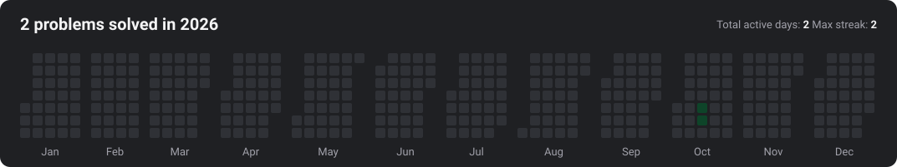

#  TUF-Solutions

> Auto-synced with **TUF+Solutions**: Solutions for [TakeUForward (TUF+)](https://takeuforward.org/)

##  Solution Progress Summary

| Total Solved | Easy | Medium | Hard | Last Synced |
| :---: | :---: | :---: | :---: | :---: |
| **2** | 0 | 2 | 0 | `2026-10-16` |

---

##  Activity

Daily log 2026 (2 active days)

- **2026-10-16** (1): [Majority Element-II](./DSA/Arrays/majority-element-ii)
- **2026-10-15** (1): [Majority Element-I](./DSA/Arrays/majority-element-i)

---

##  Solved Problems Index

### DSA (2)

| **#** | [Title](README_by_title.md) | Solution(s) | [Difficulty](README_by_difficulty.md) | [Topic](README_by_topic.md) | [Last Synced](README_by_date.md) | Notes |
| :---: | :--- | :---: | :---: | :--- | :---: | :---: |
| 0001 | [Majority Element-I](./DSA/Arrays/majority-element-i) | [JAVA](./DSA/Arrays/majority-element-i/solution.java) |  | `Arrays` | `2026-10-15` | - |
| 0002 | [Majority Element-II](./DSA/Arrays/majority-element-ii) | [JAVA](./DSA/Arrays/majority-element-ii/solution.java) |  | `Arrays` | `2026-10-16` | [NOTES](./DSA/Arrays/majority-element-ii/NOTES.md) |

---

  Auto-synced with <strong>TUF+Solutions</strong> &nbsp;|&nbsp; Practice on <a href="https://takeuforward.org/">TakeUForward (TUF+)</a>

